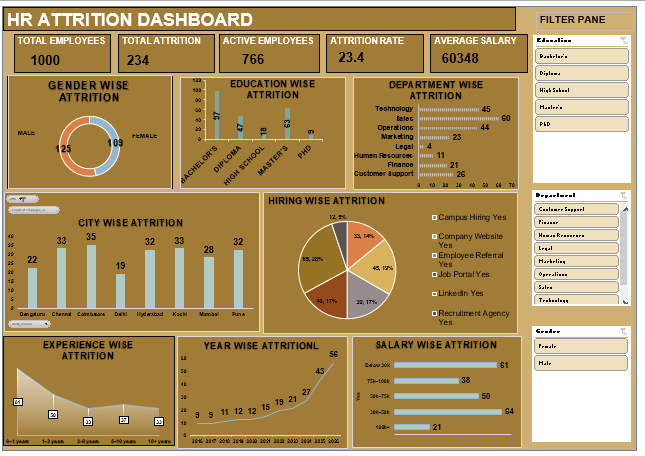

# HR Attrition Analysis Dashboard | Excel

## Project Overview
This project analyzes employee attrition using Microsoft Excel. The interactive dashboard provides insights into employee demographics, workforce distribution, hiring trends, and attrition patterns to help HR teams understand employee turnover.

## Tools Used
- Microsoft Excel
- Power Query
- Pivot Tables and Pivot Charts
- Excel Formulas
- Slicers

## Key Performance Indicators (KPIs)
- **Total Employees:** 1,000
- **Total Attrition:** 234
- **Active Employees:** 766
- **Attrition Rate:** 23.40%
- **Average Salary:** 60,348

## Dashboard Analysis
The dashboard includes:
- Gender-wise attrition
- Education-wise attrition
- Department-wise attrition
- City-wise attrition
- Hiring-wise attrition
- Experience-wise attrition
- Year-wise attrition
- Salary-wise attrition

## Dashboard Preview

## Key Insights
- The overall attrition rate is 23.40%.
- A total of 234 employees have left the organization.
- The dashboard allows interactive filtering by education, department, and gender.

## Project Objective
To analyze employee turnover patterns, identify areas with higher attrition, and support data-driven HR decisions.
